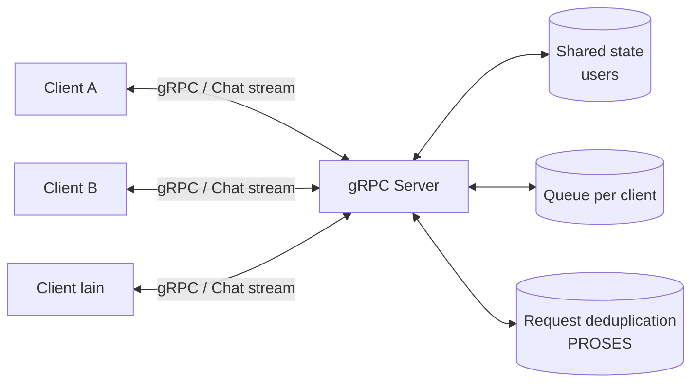

<div align="center">

# Distributed Chat Room RPC

**Sistem obrolan real-time multi-user berbasis gRPC dan Protocol Buffers v3**

[](https://www.python.org/)
[](https://grpc.io/)
[](https://protobuf.dev/)
[](https://www.docker.com/)

*Proyek Mata Kuliah Komputasi Paralel dan Terdistribusi*

</div>

> Implementasi ruang obrolan terdistribusi dengan komunikasi dua arah (*bidirectional streaming*), pengelolaan konkurensi, toleransi kegagalan, dan deduplikasi pesan.

## 🧭 Navigasi

- [Gambaran Umum](#gambaran-umum)
- [Fitur Utama](#-fitur-utama)
- [Tech Stack & Prasyarat](#️-tech-stack--prasyarat)
- [Panduan Memulai Cepat](#-panduan-memulai-cepat-getting-started)
- [Menjalankan Aplikasi](#-menjalankan-aplikasi)
- [Pengujian Otomatis](#-pengujian-otomatis-automated-testing)
- [Benchmark](#-pengujian-kinerja-benchmark-1-5-20-client)
- [Docker Compose](#-menjalankan-dengan-docker-compose)
- [Struktur Proyek](#-struktur-direktori-proyek)
- [Format Pengumpulan](#-format-pengumpulan-sesuai-ketentuan-dosen)
- [Batasan Teknis](#️-batasan-arsitektur--catatan-teknis)
- [Tim Pengembang](#-tim-pengembang)

## Gambaran Umum

Proyek ini mengimplementasikan studi kasus obrolan real-time dengan komunikasi dua arah (*bidirectional streaming*), isolasi antrean per client, sinkronisasi memori bersama (*shared memory state*), toleransi kegagalan dengan *exponential backoff retry*, serta deduplikasi pesan (*at-most-once semantics*).

### Alur komunikasi



### Ringkasan antarmuka RPC

| RPC | Tipe komunikasi | Fungsi |
|---|---|---|
| `Join` | Unary | Registrasi pengguna dan penetapan `user_id` unik |
| `ListUsers` | Unary | Mengambil snapshot pengguna online |
| `SendMessage` | Unary | Mengirim pesan dengan deduplikasi `request_id` |
| `Chat` | Bidirectional streaming | Komunikasi pesan real-time dua arah |

---

## 📋 Fitur Utama

- **4 RPC Sesuai Diagram Arsitektur**:
  1. `Join`: Registrasi pengguna baru/sesi dengan penetapan `user_id` unik.
  2. `ListUsers`: Pengambilan daftar snapshot pengguna yang sedang online.
  3. `SendMessage`: Pengiriman pesan mandiri (Unary RPC) dengan deduplikasi `request_id`.
  4. `Chat`: Komunikasi real-time dua arah (*Bidirectional Streaming RPC*).
- **In-Memory Concurrency Control**:
  - `users`: Registrasi pengguna aktif yang dilindungi `threading.RLock()` dengan *critical section* minimal.
  - `queue`: Antrean pesan terisolasi per client (`queue.Queue`) dengan kebijakan *drop-oldest* untuk mengisolasi *slow client*.
  - `PROSES`: Penyimpanan hasil pemrosesan request untuk menyaring duplikasi pesan akibat retry jaringan.
- **Toleransi Kegagalan (Fault Tolerance)**:
  - Batas waktu tunggu (*Timeout*) pada seluruh panggilan Unary RPC.
  - *Retry* dengan jeda eksponensial (*Exponential Backoff*) dan *random jitter* pada kegagalan sementara.
  - ID permintaan (`request_id`) stabil untuk mencegah publikasi ganda.
  - Pembersihan sesi otomatis (*Graceful Disconnect*) saat koneksi client terputus.
- **Uji Kinerja Komprehensif**:
  - Pengujian latensi rata-rata dan throughput pada **1, 5, dan 20 client bersamaan**.
  - Ekspor metrik otomatis ke format JSON, CSV, dan grafik visualisasi PNG.
- **Dukungan Kontainer Multi-Node**:
  - `Dockerfile` multi-stage berbasis `python:3.11-slim` dengan pengguna non-root (`appuser`).
  - `docker-compose.yml` untuk menjalankan server dan beberapa client dalam jaringan terisolasi.

---

## 🛠️ Tech Stack & Prasyarat

- **Bahasa**: Python 3.10 ke atas (diuji dan diverifikasi pada `Python 3.11.9`)
- **Pustaka Inti**:
  - `grpcio >= 1.60.0`
  - `grpcio-tools >= 1.60.0`
  - `protobuf >= 4.25.0`
- **Pustaka Pendukung**:
  - `pytest >= 8.0.0` (Automated Testing)
  - `tabulate >= 0.9.0` (Format Tabel CLI)
  - `matplotlib >= 3.8.0` (Visualisasi Grafik Benchmark)
- **Containerization**: Docker & Docker Compose (opsional untuk deployment multi-container)

---

## Urutan Penggunaan

Untuk menjalankan proyek secara lokal, ikuti urutan berikut:

1. Buat dan aktifkan virtual environment.
2. Instal dependensi dari `requirements.txt`.
3. (Opsional) Generate ulang stub jika kontrak `.proto` diubah.
4. Jalankan server gRPC.
5. Jalankan dua atau lebih client pada terminal terpisah.
6. Jalankan pengujian dan benchmark untuk memeriksa perilaku serta kinerja sistem.

---

## 🚀 Panduan Memulai Cepat (Getting Started)

### 1. Persiapan Virtual Environment (`venv`)

Buat virtual environment di root folder proyek:

```powershell
# Windows PowerShell
python -m venv venv
.\venv\Scripts\Activate.ps1
```

*Jika menggunakan Command Prompt (cmd.exe):*
```cmd
venv\Scripts\activate.bat
```

*Jika menggunakan Linux / macOS:*
```bash
python3 -m venv venv
source venv/bin/activate
```

### 2. Instalasi Dependensi

Pastikan pip diperbarui dan instal seluruh dependensi proyek:

```powershell
python -m pip install --upgrade pip
python -m pip install -r requirements.txt
```

Verifikasi instalasi berhasil:
```powershell
python -m pip check
python -c "import grpc, google.protobuf; print('gRPC dan Protobuf berhasil diimpor')"
```

### 3. Kompilasi Protocol Buffers (Generate Stubs)

Stub gRPC telah tersedia di folder `src/chat_room/`. File `proto/chat_room.proto` merupakan kontrak antarmuka. Stub gRPC hasil generate telah tersedia di `src/chat_room/`. Jika Anda mengubah file `.proto`, lakukan kompilasi ulang dengan skrip:

```powershell
python scripts/generate_stubs.py
```

---

## 💻 Menjalankan Aplikasi

### A. Menjalankan Server gRPC

Buka terminal pertama dan jalankan server pada port default `50051`:

```powershell
python src/chat_room/server.py --port 50051 --workers 30
```

Parameter yang tersedia:
- `--host`: Alamat bind (default: `0.0.0.0`).
- `--port`: Port server gRPC (default: `50051`).
- `--workers`: Jumlah thread pool executor (default: `30`).

### B. Menjalankan Client CLI A (Alice)

Buka terminal kedua dan jalankan client pertama:

```powershell
python src/chat_room/client.py --server localhost:50051 --username Alice
```

### C. Menjalankan Client CLI B (Bob)

Buka terminal ketiga dan jalankan client kedua:

```powershell
python src/chat_room/client.py --server localhost:50051 --username Bob
```

### Perintah Interaktif pada Terminal Client:
- **Ketik teks biasa**: Mengirim pesan real-time melalui *bidirectional stream*.
- `/users`: Melihat daftar pengguna aktif yang sedang online.
- `/unary <pesan>`: Mengirim pesan melalui jalur Unary `SendMessage` dengan deduplikasi `request_id`.
- `/help`: Menampilkan ringkasan bantuan perintah.
- `/exit` atau `/quit`: Keluar dari ruang obrolan secara tertib.

> **Catatan penggunaan:** Jalankan server terlebih dahulu sebelum membuka client. Untuk menguji komunikasi antar pengguna, jalankan setiap client pada terminal terpisah dan gunakan alamat server yang sama.


---

## 🧪 Pengujian Otomatis (Automated Testing)

Rangkaian tes mencakup 22 skenario pengujian unit dan integrasi untuk memastikan keandalan sistem:
- Registrasi `Join` & penolakan nama duplikat.
- Pengambilan daftar pengguna `ListUsers`.
- Pengiriman pesan `SendMessage`.
- Aliran dua arah `Chat` (Join, Message, Heartbeat).
- Broadcast pesan antar Client A dan Client B secara riil.
- Penanganan pembersihan sesi saat client disconnect.
- Concurrency 20 thread tanpa race condition.
- Deduplikasi pesan di `PROSES`.
- Client timeout & retry dengan exponential backoff.
- Penanganan input invalid & kode error gRPC.
- Isolasi slow client pada antrean pesan.
- Siklus hidup server & graceful shutdown.

Jalankan seluruh pengujian dengan perintah:

```powershell
python -m pytest -v
```

---

## 📊 Pengujian Kinerja (Benchmark 1, 5, 20 Client)

Skrip benchmark menguji throughput dan latensi gRPC secara riil:

```powershell
python benchmarks/run_benchmark.py --clients 1,5,20 --messages 50
```

Jalankan perintah dari root direktori proyek. Sesuaikan jumlah client atau pesan melalui argumen `--clients` dan `--messages` bila diperlukan.

Hasil pengujian otomatis tersimpan pada:
- **JSON**: `benchmarks/results/benchmark_results.json`
- **CSV**: `benchmarks/results/benchmark_results.csv`
- **Grafik**: `benchmarks/results/latency_throughput_chart.png`

---

## 🐳 Menjalankan dengan Docker Compose

Untuk menguji komunikasi antar-container pada jaringan bridge Docker:

```powershell
# 1. Pastikan Docker Desktop sedang aktif
# 2. Build image
docker compose build

# 3. Jalankan server
docker compose up -d chat-server

# 4. Hubungkan Client A di terminal 1
docker compose run --rm chat-client-a

# 5. Hubungkan Client B di terminal 2
docker compose run --rm chat-client-b

# 6. Hentikan container
docker compose down
```

---

## 📂 Struktur Direktori Proyek

```
RPC_CHAT/
├── proto/
│   └── chat_room.proto            # Kontrak antarmuka Protocol Buffers v3
├── src/
│   └── chat_room/
│       ├── __init__.py            # Inisialisasi package & sys.path patch
│       ├── config.py              # Konfigurasi default (port, worker, buffer)
│       ├── state.py               # Shared state di memori (users, queue, PROSES)
│       ├── service.py             # Implementasi 4 RPC LayananChat
│       ├── server.py              # Server gRPC dengan ThreadPoolExecutor
│       ├── client.py              # Client CLI interaktif dengan timeout & retry
│       ├── chat_room_pb2.py       # Generated protobuf messages
│       └── chat_room_pb2_grpc.py  # Generated gRPC client/server stubs
├── tests/
│   ├── conftest.py                # Fixtures pytest untuk server/stub ephemeral
│   ├── test_join.py               # Pengujian RPC Join
│   ├── test_list_users.py         # Pengujian RPC ListUsers
│   ├── test_send_message.py       # Pengujian RPC SendMessage
│   ├── test_chat_stream.py        # Pengujian Bidirectional Streaming
│   ├── test_broadcast.py          # Pengujian broadcast antarklien riil
│   ├── test_disconnect.py         # Pengujian penanganan disconnect
│   ├── test_concurrency.py        # Pengujian multi-threading 20 client
│   ├── test_deduplication.py      # Pengujian deduplikasi request_id
│   ├── test_timeout_retry.py      # Pengujian timeout & retry backoff
│   ├── test_errors.py             # Pengujian validasi input & error status
│   ├── test_queue_backpressure.py # Pengujian antrean slow client
│   └── test_server_lifecycle.py   # Pengujian start & stop server
├── benchmarks/
│   ├── run_benchmark.py           # Skrip pengujian beban 1, 5, 20 client
│   └── results/                   # Artefak metrik (CSV, JSON, PNG)
├── docs/
│   ├── architecture.md            # Dokumentasi arsitektur sistem
│   ├── requirements-matrix.md     # Matriks pelacakan persyaratan
│   ├── skill-usage-audit.md       # Audit pembacaan 17 skill lokal
│   ├── environment-setup.md       # Panduan detail konfigurasi environment
│   ├── benchmark-analysis.md      # Laporan analisis kinerja & scaling
│   ├── draf-laporan-proyek.md     # Template laporan proyek untuk mahasiswa
│   └── decisions/                 # Architecture Decision Records (ADRs)
├── laporan/                       # Berkas Laporan Akhir & Pengumpulan Resmi
│   ├── Kelompok3_ProyekRPC.zip    # Paket arsip pengumpulan resmi (PDF + Source Code)
│   ├── Laporan_Proyek_Mini_RPC_Kelompok3.pdf   # Laporan akademik resmi (45 halaman)
│   ├── Laporan_Proyek_Mini_RPC_Kelompok3.docx  # Naskah asli Word terkompilasi
│   ├── QA_REVISION_REPORT.md      # Laporan verifikasi dan audit mutu dokumen
│   ├── assets/                    # Diagram (PNG), grafik kinerja, dan tangkapan layar
│   └── evidence/                  # Log pengujian mentah, JSON, CSV, dan output pytest
├── scripts/                       # Otomatisasi Build, Pengujian, dan Dokumentasi
│   ├── generate_stubs.py          # Kompilasi Protobuf ke stub Python
│   ├── generate_visuals.py        # Pembuatan 5 diagram arsitektur & grafik tolok ukur
│   ├── generate_screenshots.py    # Eksekusi skenario nyata & capture terminal
│   ├── build_report_docx.py       # Pembuatan naskah DOCX akademik profesional
│   ├── export_report_pdf.py       # Update Word COM (TOC, TOF, TOT) & ekspor PDF
│   ├── verify_report_quality.py   # Pemeriksaan mutu PDF (0 halaman kosong, 0 error)
│   └── package_submission.py      # Pembuatan arsip pengumpulan Kelompok3_ProyekRPC.zip
├── Dockerfile                     # Image definition dengan non-root user
├── docker-compose.yml             # Orchestration server dan 2 client
├── requirements.txt               # Daftar dependensi Python
├── pyproject.toml                 # Konfigurasi package & build system
├── HUMAN_RUNBOOK.md               # Panduan verifikasi manual mahasiswa
└── arsitektur-chat-room.svg       # Diagram arsitektur acuan dari Claude
```

---

## 📦 Format Pengumpulan Sesuai Ketentuan Dosen

Berdasarkan dokumen pedoman perkuliahan **Latihan & Praktikum RPC (Halaman 13)**:
- **Format Berkas Proyek**: `Kelompok<no>_ProyekRPC.zip` berisi laporan PDF dan seluruh kode sumber.
- **Nama Berkas Pengumpulan**: `Kelompok3_ProyekRPC.zip` (tersedia di direktori `laporan/Kelompok3_ProyekRPC.zip`).
- **Isi Paket Pengumpulan**:
  1. `Laporan_Proyek_Mini_RPC_Kelompok3.pdf`: Laporan lengkap 45 halaman mencakup diagram arsitektur, penjelasan file `.proto`, strategi concurrency, analisis kinerja beban, pembagian tugas anggota, serta tautan repositori Git.
  2. `Laporan_Proyek_Mini_RPC_Kelompok3.docx`: Naskah Word asli untuk fleksibilitas editing.
  3. `source_code/`: Kode sumber lengkap yang dapat langsung dijalankan sesuai petunjuk di `README.md`.

---

## ⚠️ Batasan Arsitektur & Catatan Teknis

1. **Shared State Volatil**: Seluruh state (`users`, `queue`, `PROSES`) disimpan di dalam memori RAM server. Jika proses server dimatikan atau restart, state akan tereset ke kondisi awal.
2. **Semantik At-Most-Once**: Jaminan deduplikasi bertahan selama siklus hidup server yang berjalan (*ephemeral in-memory deduplication*).
3. **Slow Client Policy**: Jika antrean client streaming penuh (`maxsize=100`), server akan membuang pesan tertua (*drop oldest*) agar publisher dan client lain tidak mengalami kemacetan (*head-of-line blocking*).

---

## 👥 Tim Pengembang

- Proyek Mini Komputasi Paralel dan Terdistribusi
- Lihat `docs/draf-laporan-proyek.md` untuk rincian kontribusi masing-masing anggota kelompok.

---

## 📚 Dokumentasi Tambahan

Untuk pendalaman implementasi dan proses verifikasi, proyek juga menyediakan:

- `docs/architecture.md` — penjelasan arsitektur sistem.
- `docs/requirements-matrix.md` — pemetaan persyaratan terhadap implementasi.
- `docs/environment-setup.md` — konfigurasi lingkungan secara lebih rinci.
- `docs/benchmark-analysis.md` — analisis hasil benchmark dan scaling.
- `HUMAN_RUNBOOK.md` — panduan verifikasi manual.

Lihat struktur direktori di atas untuk daftar dokumentasi, skrip otomatisasi, artefak pengujian, dan berkas laporan lainnya.

